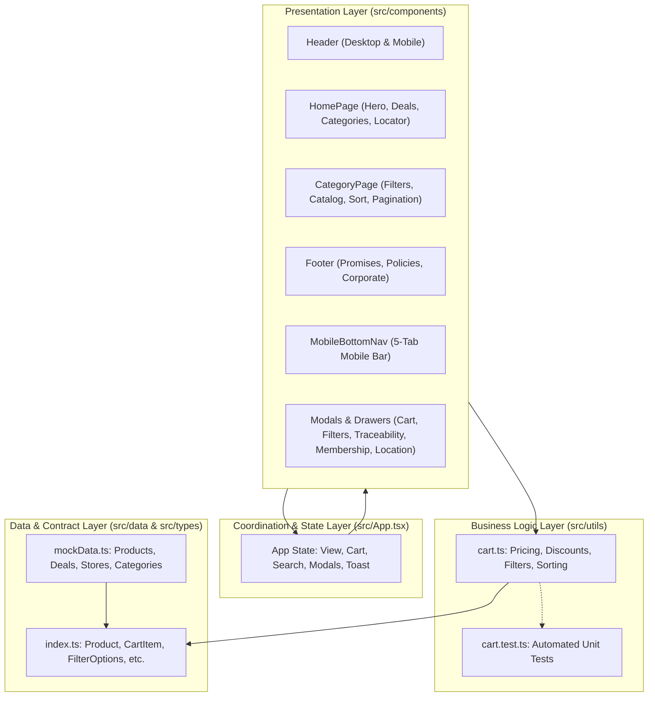

# Architecture Rules & System Design

> Defines the structural layers, component hierarchy, state flow, and data flow of **Satrafoods**.

---

## 1. System Architecture Overview

Satrafoods is designed as a high-performance, responsive e-commerce web application with a clean, layered component architecture:

---

## 2. Component Hierarchy & Responsibilities

1. **Root Coordinator (`src/App.tsx`)**:
   - Manages top-level view state (`'home' | 'category'`).
   - Maintains the single source of truth for the active shopping cart (`cartItems: CartItem[]`).
   - Coordinates visibility for modals and flyouts (`CartDrawer`, `LocationModal`, `MembershipModal`, `TraceabilityModal`).
   - Dispatches temporary user-facing toast notifications.

2. **Navigation Surfaces**:
   - **`Header.tsx`**: Dual-mode navigation:
     - *Desktop*: 3-column top bar (Delivery + Search, Center Brand Logo, Membership + Cart + Avatar) + green category mega-menu sub-bar.
     - *Mobile*: 3-tier compact stack (Logo + 2H Location + Cart, Full-width search input, Horizontal category pill scroll).
   - **`MobileBottomNav.tsx`**: Mobile-only (`md:hidden`) fixed 5-tab bar adhering to iOS/Android safe area guidelines.

3. **Page Views**:
   - **`HomePage.tsx`**: High-conversion landing page containing the hero banner, countdown flash sales ("Gói Trọn Ưu Đãi"), first-order voucher lead generation, 18-category visual grid, and interactive 180+ store locator.
   - **`CategoryPage.tsx`**: High-density e-commerce catalog featuring VietGAP commitment mini-banner, multi-criteria sidebar filters (desktop) / filter drawer (mobile), search result indicators, sorting bar, grid/list view toggles, product cards with QR provenance triggers, and pagination.

4. **Modals & Flyouts**:
   - **`CartDrawer.tsx`**: Sliding right drawer displaying live item count, free-shipping tier calculator (>= 200.000đ), 2% Satra Rewards discount deduction, coupon verification (`SATRAFRESHT3`, `SATRA50K`), and order generation.
   - **`MobileFilterDrawer.tsx`**: Slide-out bottom-sheet for mobile devices to prevent long filter lists from displacing product cards.
   - **`TraceabilityModal.tsx`**: Authentic VietGAP provenance modal displaying farm origin, harvest time, batch ID, certification badges, and 24h quality guarantee.
   - **`MembershipModal.tsx`**: Satra Rewards membership card simulation with point accumulation.
   - **`LocationModal.tsx`**: District selector for express 2-hour delivery across HCMC and Can Tho.

---

## 3. State Management Principles

- **Unidirectional Data Flow**: Data flows down via props; user interactions dispatch upward callbacks.
- **Colocation of State**: Keep state as close to where it is consumed as possible. Do not hoist state to `App.tsx` unless multiple independent components require access to it.
- **Memoized Calculations**: Use `useMemo` for computationally expensive filtering and sorting operations over product catalogs.
- **Zero Third-Party State Overhead**: Do not introduce Redux, MobX, or Zustand without explicit architectural justification. Native React state (`useState`, `useMemo`, `useCallback`) is the project standard.

---

## 4. Architectural Invariants

1. **No Direct DOM Manipulation**: Always use React state and declarative JSX. Never use `document.querySelector` or direct DOM manipulation for application state.
2. **Pure Utility Functions**: Functions in `src/utils/` must remain pure, side-effect free, and easily unit-testable.
3. **No Dead Code**: Remove unused imports, variables, and commented-out code before completing any task.
4. **Preserve User Changes**: Never overwrite or revert functionality built by other agents or users.
